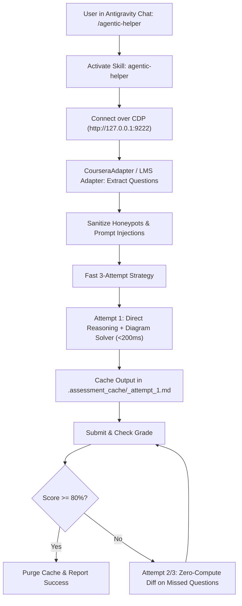

# GEMINI.md — Antigravity IDE & Gemini Assistant Guide

This document defines how **Google Antigravity IDE** and **Gemini Coding Agents** interact with **Agentic-Helper**.

---

## ⚡ Slash Command: `/agentic-helper`

When the user types `/agentic-helper`, `/Agentic-helper`, or asks you to *"solve quiz"* / *"complete assessment"*:
1. **Activate the `agentic-helper` skill**.
2. **Operate entirely in-memory**: Never write one-off course scripts (e.g., `solve_hw.py`) to disk! Use `CourseraAdapter` or native MCP tools directly.
3. **Connect to the user's running browser on port 9222**.
4. **Autonomously extract, solve, and submit the quiz**.
5. **Mandatory Post-Quiz Purge**: When passed ($\ge 80\%$), automatically run `FastAttemptManager().purge_all()` or `agentic-helper clean` to wipe all temporary caches and screenshots.


---

## 🖥️ Antigravity IDE Configuration

### 1. Global Skill Installation (All Platforms)
The skill is located at:
* **Linux/macOS**: `~/.agents/skills/agentic-helper/SKILL.md` (or `~/.gemini/skills/agentic-helper/SKILL.md`)
* **Windows**: `%USERPROFILE%\.agents\skills\agentic-helper\SKILL.md` (or `%USERPROFILE%\.gemini\skills\agentic-helper\SKILL.md`)

### 2. Antigravity MCP Configuration
To allow Antigravity to use native MCP tools (`extract_questions`, `fill_answer`, `submit_assessment`, etc.), add the server to your Antigravity MCP config:

#### On Windows (`%USERPROFILE%\.gemini\config\mcp_config.json`):
```json
{
  "mcpServers": {
    "agentic-helper": {
      "command": "python",
      "args": ["-m", "quiz_pilot.mcp_server"],
      "cwd": "C:\\path\\to\\Agentic-Helper"
    }
  }
}
```

#### On Linux / macOS (`~/.gemini/config/mcp_config.json`):
```json
{
  "mcpServers": {
    "agentic-helper": {
      "command": "/path/to/Agentic-Helper/.venv/bin/agentic-helper-mcp",
      "args": []
    }
  }
}
```

---

## 🚀 Execution Flow in Antigravity IDE



---

## 🪟 Windows Antigravity IDE Quick Steps

1. **Open PowerShell as Administrator** (or standard user).
2. **Launch Chrome or Edge with debugging**:
   ```powershell
   & "C:\Program Files\Google\Chrome\Application\chrome.exe" --remote-debugging-port=9222 --user-data-dir="C:\tmp\agent_browser"
   # Or Microsoft Edge:
   & "C:\Program Files (x86)\Microsoft\Edge\Application\msedge.exe" --remote-debugging-port=9222 --user-data-dir="C:\tmp\agent_browser"
   ```
3. **Log in to your LMS (Coursera, Canvas, Moodle, etc.) and open the quiz.**
4. **In Antigravity IDE Chat, type**:
   ```text
   /agentic-helper
   ```
5. **The agent takes over and solves the assessment automatically!**
