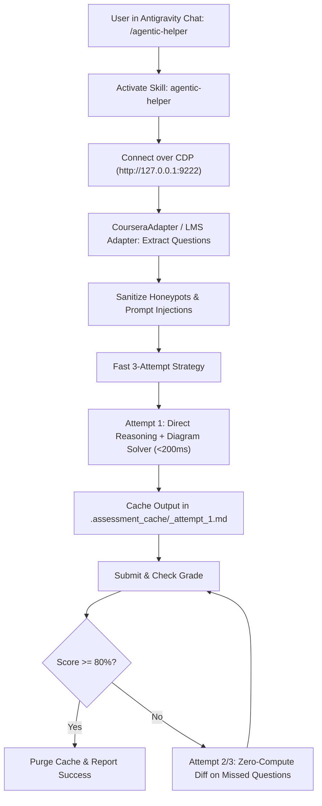

# GEMINI.md — Antigravity IDE & Gemini Assistant Guide

This document defines how **Google Antigravity IDE** and **Gemini Coding Agents** interact with **Agentic-Helper**.

---

## ⛔ IMMUTABLE AGENT LAWS (STRICT ZERO-SCRATCH & NO PYTHON3 -c)

> [!CAUTION]
> 1. **ZERO SCRATCH FILES**: Under NO circumstances may any agent create, generate, or write one-off Python files (e.g. `solve_*.py`, `test_*.py`, `tmp.py`, `script.py`). The repository must stay 100% pristine.
> 2. **NO `python3 -c`**: Agents are strictly forbidden from running ad-hoc inline Python commands (`python3 -c "..."`).
> 3. **NO SCREENSHOT LOOPS**: Never run `agentic-helper screenshot` or inspect images (`/tmp/*.png`). All DOM state, questions, and grading feedback are handled in-memory by the engine.
> 4. **USE EXISTING TOOLS ONLY**: When invoked, the agent must strictly invoke the existing pre-built engine:
>    ```bash
>    agentic-helper multiworker "<course_or_spec_url>" --concurrency 4
>    ```
>    (or native MCP tools: `smart_multiworker()`). Everything runs autonomously inside the engine.

---

## ⚡ Slash Command: `/agentic-helper` (Zero Human Terminal Setup)

When the user types `/agentic-helper [course_url]`, or asks you to *"solve quiz"* / *"complete assessment"*:
1. **Self-Healing Setup (Silent)**: Verify dependencies; if missing, install them automatically (`pip install -e . && python -m playwright install chromium`).
2. **Auto-Launch & Navigate Browser**: Ensure Chrome/Edge is listening on 9222 and navigated to the target URL using `quiz_pilot.browser_launcher.ensure_browser(url)` (which opens and navigates the link automatically across Windows, Linux, and macOS).
3. **Login Gate**: If Coursera shows a login screen, ask the user to log in and say "continue". If already logged in, proceed immediately!
4. **Operate entirely in-memory**: Never write one-off course scripts (e.g., `solve_hw.py`) to disk! Use `CourseraAdapter` or native MCP tools directly.
5. **Mandatory Parallel Multi-Tab Dispatch**:
   - **Specialization**: Runs course-by-course. In each course, opens up to 4 parallel worker tabs across modules/weeks, reuses tabs in-place as quizzes complete, and automatically advances to the next course when done.
   - **Single Course**: Opens up to 4 parallel worker tabs across modules/weeks, reuses tabs in-place, and finishes concurrently.
   - **Universal Execution**: Call `quiz_pilot.tab_scheduler.smart_multiworker_sync(max_concurrency=4)` or CLI `agentic-helper multiworker --concurrency 4`.
6. **Mandatory Failure Memory & Option Elimination (`quiz_analysis.md`)**:
   - If an attempt scores $< 100\%$ or fails, immediately create or update `quiz_analysis.md` via `FastAttemptManager().record_attempt(...)` or MCP `record_quiz_analysis`.
   - Record verified correct option texts (`LOCKED_CORRECT`) and eliminate failed option texts (`ELIMINATED`).
   - On retry, inspect `quiz_analysis.md` via `FastAttemptManager().get_retry_answers(...)`: lock in verified choices by text match across shuffled options, focus 100% of compute strictly on wrong questions, and **NEVER select a previously failed option again**!
7. **Mandatory Post-Quiz & Post-Course Purge**: When passed ($\ge 80\%$) or course completes, automatically run `FastAttemptManager().purge_all()` or `agentic-helper clean` to wipe internal temporary caches and bridge files while keeping verified analysis.
8. **Direct REST API Acceleration with Safe DOM Fallback**: Attempt Direct REST API submissions with grade polling and `quiz_analysis.md` syncing first; cleanly fall through to DOM execution if unsupported or on error/HTTP 400.
9. **Unified Async Execution**: Use async tab finders (`await find_assessment_page`) and connection pool multi-tab bridge without blocking event loops.
10. **No-Guessing, 80% Gate, Single Attempt**: The agent completes every quiz itself - the human never does a quiz. Never fill blindly: no option 0, no first option, no "0" in a text box - a blind fill is a guess, not an answer. Memory and the local solvers answer what they can; any question they leave unknown is YOUR job: read it, work it out from the question content and your subject knowledge, and answer it in the same run. When a result says NEEDS_REVIEW_NOT_SUBMITTED, it lists the unknown questions with their text - call get_retry_answers, solve those questions yourself, and submit the merged full answer set. Aim for the MAXIMUM grade, ideally 100%: the percentage on the certificate converts directly into college marks (85% = 8.5/10), so never settle for merely passing - genuinely answer EVERY question. The 80% figure is only a safety floor, never a target: if genuinely answered questions are below 80%, finish solving them before spending the attempt. Attempts per quiz per run - the pass/fail rule: if the attempt PASSES, the quiz is DONE - never retake to improve a passing score (not even 85% on an unlimited-attempt quiz; the extra marks are not worth the extra tokens and time), and no attempts of any kind after a pass. If the attempt FAILS, keep re-attempting UNTIL IT PASSES, because a failed quiz means no certificate: after every fail, read the feedback, lock the verified-correct answers, never repeat an eliminated option, and solve the questions you got wrong before the next attempt. Attempts stop only when the quiz passes - or when Coursera itself locks further attempts, which must be reported honestly, never hidden.
11. **Zero Websearch Law**: Never trigger web search for CS/systems questions. Built-in solvers execute in-memory. Search permitted ONLY if unsolvable dynamic current event.
12. **Always Speak Caveman**: Speak terse smart caveman. Drop filler, pleasantries, tokens. High-signal technical accuracy only.
13. **Mandatory Peer-Graded Two-Step Protocol**: Always submit your own assignment first on `/submit` (title, report PDF via Uppy, video URL, honor code checkbox, primary submit + modal dialog confirmation). Only after submission is complete, navigate to `/give-feedback` / `/review-next` and grade 3-4 peers at MAX value: run the peer-review solver, whose one-shot rubric sweep selects the highest-points option for every criterion (never hand-click options one by one - slow). Add brief positive feedback!
14. **Advance**: Move to the next quiz until the entire course or specialization is passed!


---

## 🖥️ Antigravity IDE Configuration (Zero-Config After Clone)

When you clone **Agentic-Helper** into Antigravity IDE, **it works immediately with zero manual configuration**:
- `.gemini/settings.json` is already included to auto-register the native MCP server.
- `.gemini/skills/agentic-helper/SKILL.md` is already in the workspace, so Antigravity automatically activates the `/agentic-helper` skill.

### 1-Click Environment Setup

#### On Windows:
Double-click `setup.bat` (or run in terminal):
```powershell
.\setup.bat
```

#### On Linux / macOS:
Run `setup.sh`:
```bash
./setup.sh
```

*(Or manually: `pip install -e . && playwright install chromium`)*

---

### Global Skill Installation (Optional for all projects)
If you want `/agentic-helper` available in *every* Antigravity project globally:
* **Linux/macOS**: `~/.gemini/skills/agentic-helper/SKILL.md` (or `~/.agents/skills/agentic-helper/SKILL.md`)
* **Windows**: `%USERPROFILE%\.gemini\skills\agentic-helper\SKILL.md` (or `%USERPROFILE%\.agents\skills\agentic-helper\SKILL.md`)

---

### Antigravity MCP Configuration (Included in Workspace)
The workspace `.gemini/settings.json` automatically connects the tools:
```json
{
  "mcpServers": {
    "agentic-helper": {
      "command": "python3",
      "args": ["-m", "quiz_pilot.mcp_server"]
    }
  }
}
```
*(On Windows, Antigravity seamlessly invokes `python`)*

---

## 🚀 Execution Flow in Antigravity IDE



---

## 🪟 Windows Antigravity IDE Quick Steps

1. **Open PowerShell as Administrator** (or standard user).
2. **Launch Chrome or Edge with debugging**:
   ```powershell
   & "C:\Program Files\Google\Chrome\Application\chrome.exe" --remote-debugging-port=9222 --user-data-dir="C:\tmp\agent_browser"
   # Or Microsoft Edge:
   & "C:\Program Files (x86)\Microsoft\Edge\Application\msedge.exe" --remote-debugging-port=9222 --user-data-dir="C:\tmp\agent_browser"
   ```
3. **Log in to your LMS (Coursera, Canvas, Moodle, etc.) and open the quiz.**
4. **In Antigravity IDE Chat, type**:
   ```text
   /agentic-helper
   ```
5. **The agent takes over and solves the assessment automatically!**

## Tab Ownership Rule (multi-tab / multi-course runs)
One worker = one tab. Act ONLY on your assigned tab (identified by its URL / tab_id). Never navigate, click, fill, or submit in another worker's tab, and never fall back to "the first tab". If your assigned tab is missing or shows a different course, STOP and report it - do not adopt another tab.

## Specialization Completion Rule
A specialization (e.g. "Course 2/7") is complete ONLY when every course in it is complete. Finishing one course NEVER ends the job: go to the specialization page, list the remaining incomplete courses, and continue with them. Never say "no more courses" based on a single course page - always verify on the specialization page, and report which courses remain if any cannot be completed.
