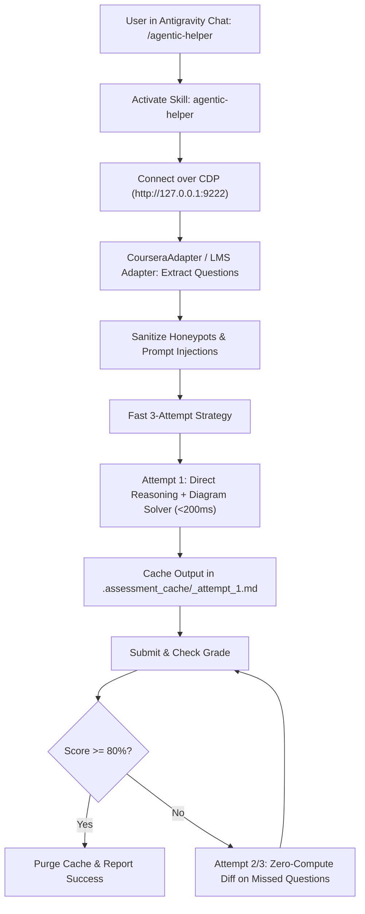

# GEMINI.md — Antigravity IDE & Gemini Assistant Guide

This document defines how **Google Antigravity IDE** and **Gemini Coding Agents** interact with **Agentic-Helper**.

---

## ⚡ Slash Command: `/agentic-helper` (Zero Human Terminal Setup)

When the user types `/agentic-helper [course_url]`, or asks you to *"solve quiz"* / *"complete assessment"*:
1. **Self-Healing Setup (Silent)**: Verify dependencies; if missing, install them automatically (`pip install -e . && python -m playwright install chromium`).
2. **Auto-Launch & Navigate Browser**: Ensure Chrome/Edge is listening on 9222 and navigated to the target URL using `quiz_pilot.browser_launcher.ensure_browser(url)` (which opens and navigates the link automatically across Windows, Linux, and macOS).
3. **Login Gate**: If Coursera shows a login screen, ask the user to log in and say "continue". If already logged in, proceed immediately!
4. **Operate entirely in-memory**: Never write one-off course scripts (e.g., `solve_hw.py`) to disk! Use `CourseraAdapter` or native MCP tools directly.
5. **The 15 Immutable Agent Rules (Strictly Enforced)**:
   - **Rule 1 (Pure In-Memory Engine Law)**: Zero scratch scripts (`solve_*.py`), zero `/tmp` builds, zero ad-hoc shell compiles.
   - **Rule 2 (ZERO External Git Cloning Law)**: Never run `git clone` to pull random student repositories for course assignments.
   - **Rule 3 (Mandatory Parallel Multi-Tab Workers)**: Never run sequentially in a single tab. Specialization courses open each child course in its own tab; single courses open modules across parallel tabs.
   - **Rule 4 (Multi-Tab & Specialization Tab Isolation)**: Zero tab collisions. Each child course runs in a dedicated `context.new_page()` tab.
   - **Rule 5 (Mandatory 100% Comprehensive Assignment Completion)**: Non-bypassable mandate: complete every item labeled "Assignment" (Graded Assignment, Peer-graded Assignment, Programming Assignment).
   - **Rule 6 (Mandatory Peer-Graded Two-Step Protocol)**: Submit report PDF & demo link first, then immediately complete 3-4 peer reviews with rapid random option marking.
   - **Rule 7 (Mandatory Failure Memory & Option Elimination)**: Record failed attempts in `quiz_analysis.md`, lock in verified choices, and deterministically eliminate wrong options.
   - **Rule 8 (Speed & Accuracy Balancing Law)**: Fast millisecond execution paired with $\ge 80\%$ passing threshold.
   - **Rule 9 (Mandatory 100% Answer Guarantee)**: Never leave any question unanswered before submission.
   - **Rule 10 (Zero Websearch Law)**: Local solvers execute in-memory; web search strictly reserved for dynamic real-time news questions.
   - **Rule 11 (Direct REST/GraphQL API First)**: Attempt Direct API first via `CourseraDirectAPI`; cleanly fall through to DOM on error.
   - **Rule 12 (Token Reduction Enforcement - Methods A, C, D)**: Filter shell outputs (`/dev/null 2>&1`), Direct REST API first, and recommend `/compact` regularly.
   - **Rule 13 (Always Speak Caveman)**: Terse smart caveman. Drop filler/pleasantries. High-signal technical accuracy only.
   - **Rule 14 (Unified Async Execution & Pool)**: Async tab lookups and persistent WebSocket connection pool across tabs.
   - **Rule 15 (Automatic Zero-Artifact Cleanup)**: Purge cache and temporary files immediately upon passing via `FastAttemptManager().purge_all()` or `quiz-pilot clean`.


---

## 🖥️ Antigravity IDE Configuration (Zero-Config After Clone)

When you clone **Agentic-Helper** into Antigravity IDE, **it works immediately with zero manual configuration**:
- `.gemini/settings.json` is already included to auto-register the native MCP server.
- `.gemini/skills/agentic-helper/SKILL.md` is already in the workspace, so Antigravity automatically activates the `/agentic-helper` skill.

### 1-Click Environment Setup

#### On Windows:
Double-click `setup.bat` (or run in terminal):
```powershell
.\setup.bat
```

#### On Linux / macOS:
Run `setup.sh`:
```bash
./setup.sh
```

*(Or manually: `pip install -e . && playwright install chromium`)*

---

### Global Skill Installation (Optional for all projects)
If you want `/agentic-helper` available in *every* Antigravity project globally:
* **Linux/macOS**: `~/.gemini/skills/agentic-helper/SKILL.md` (or `~/.agents/skills/agentic-helper/SKILL.md`)
* **Windows**: `%USERPROFILE%\.gemini\skills\agentic-helper\SKILL.md` (or `%USERPROFILE%\.agents\skills\agentic-helper\SKILL.md`)

---

### Antigravity MCP Configuration (Included in Workspace)
The workspace `.gemini/settings.json` automatically connects the tools:
```json
{
  "mcpServers": {
    "agentic-helper": {
      "command": "python3",
      "args": ["-m", "quiz_pilot.mcp_server"]
    }
  }
}
```
*(On Windows, Antigravity seamlessly invokes `python`)*

---

## 🚀 Execution Flow in Antigravity IDE



---

## 🪟 Windows Antigravity IDE Quick Steps

1. **Open PowerShell as Administrator** (or standard user).
2. **Launch Chrome or Edge with debugging**:
   ```powershell
   & "C:\Program Files\Google\Chrome\Application\chrome.exe" --remote-debugging-port=9222 --user-data-dir="C:\tmp\agent_browser"
   # Or Microsoft Edge:
   & "C:\Program Files (x86)\Microsoft\Edge\Application\msedge.exe" --remote-debugging-port=9222 --user-data-dir="C:\tmp\agent_browser"
   ```
3. **Log in to your LMS (Coursera, Canvas, Moodle, etc.) and open the quiz.**
4. **In Antigravity IDE Chat, type**:
   ```text
   /agentic-helper
   ```
5. **The agent takes over and solves the assessment automatically!**
