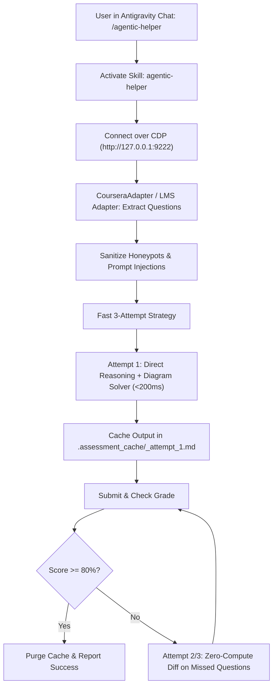

# GEMINI.md — Antigravity IDE & Gemini Assistant Guide

This document defines how **Google Antigravity IDE** and **Gemini Coding Agents** interact with **Agentic-Helper**.

---

## ⚡ Slash Command: `/agentic-helper` (Zero Human Terminal Setup)

When the user types `/agentic-helper [course_url]`, or asks you to *"solve quiz"* / *"complete assessment"*:
1. **Self-Healing Setup (Silent)**: Verify dependencies; if missing, install them automatically (`pip install -e . && python -m playwright install chromium`).
2. **Auto-Launch & Navigate Browser**: Ensure Chrome/Edge is listening on 9222 and navigated to the target URL using `quiz_pilot.browser_launcher.ensure_browser(url)` (which opens and navigates the link automatically across Windows, Linux, and macOS).
3. **Login Gate**: If Coursera shows a login screen, ask the user to log in and say "continue". If already logged in, proceed immediately!
4. **Operate entirely in-memory**: Never write one-off course scripts (e.g., `solve_hw.py`) to disk! Use `CourseraAdapter` or native MCP tools directly.
5. **Mandatory Parallel Multi-Tab Dispatch (Specialization vs Single Course)**:
   - **NEVER run sequentially in a single tab!**
   - **Specialization Course (`/specializations/<slug>`)**: Open **EACH child course in its own browser tab simultaneously** and complete all child courses in parallel concurrently in under 30 minutes!
   - **Single Course (`/learn/<slug>`)**: Open **different module quizzes in separate browser tabs simultaneously** (Week 1, Week 2, Week 3, Week 4 Quizzes) and solve all modules in parallel concurrently!
   - **Universal Execution**: Call `quiz_pilot.tab_scheduler.smart_multiworker_sync(max_concurrency=4)` or MCP tool `smart_multiworker()`.
6. **Mandatory Failure Memory & Option Elimination (`quiz_analysis.md`)**:
   - If an attempt scores $< 100\%$ or fails, immediately create or update `quiz_analysis.md` via `FastAttemptManager().record_attempt(...)` or MCP `record_quiz_analysis`.
   - Record verified correct option texts (`LOCKED_CORRECT`) and eliminate failed option texts (`ELIMINATED`).
   - On retry, inspect `quiz_analysis.md` via `FastAttemptManager().get_retry_answers(...)`: lock in verified choices by text match across shuffled options, focus 100% of compute strictly on wrong questions, and **NEVER select a previously failed option again**!
7. **Mandatory Post-Quiz Purge (per-quiz only)**: When a quiz passes ($\ge 80\%$), automatically run `FastAttemptManager().purge_cache(quiz_id)` for THAT quiz only, while keeping verified analysis. NEVER run `purge_all()` or `agentic-helper clean` yourself - a full wipe erases every quiz's memory and all Host-Packet state (`.assessment_cache/packets/`); full cleanup is manual-only, when the user asks.
8. **Direct REST API Acceleration with Safe DOM Fallback**: Attempt Direct REST API submissions with grade polling and `quiz_analysis.md` syncing first; cleanly fall through to DOM execution if unsupported or on error/HTTP 400.
9. **Unified Async Execution**: Use async tab finders (`await find_assessment_page`) and connection pool multi-tab bridge without blocking event loops.
10. **No-Guessing, 80% Gate, Single Attempt**: The agent completes every quiz itself - the human never does a quiz. Never fill blindly: no option 0, no first option, no "0" in a text box - a blind fill is a guess, not an answer. Memory and the local solvers answer what they can; any question they leave unknown is YOUR job: read it, work it out from the question content and your subject knowledge, and answer it in the same run. When a result says NEEDS_REVIEW_NOT_SUBMITTED, it lists the unknown questions with their text - call get_retry_answers, solve those questions yourself, and submit the merged full answer set. Aim for the MAXIMUM grade, ideally 100%: the percentage on the certificate converts directly into college marks (85% = 8.5/10), so never settle for merely passing - genuinely answer EVERY question. The 80% figure is only a safety floor, never a target: if genuinely answered questions are below 80%, finish solving them before spending the attempt. Attempts per quiz per run - the pass/fail rule: if the attempt PASSES, the quiz is DONE - never retake to improve a passing score (not even 85% on an unlimited-attempt quiz; the extra marks are not worth the extra tokens and time), and no attempts of any kind after a pass. If the attempt FAILS, keep re-attempting UNTIL IT PASSES, because a failed quiz means no certificate: after every fail, read the feedback, lock the verified-correct answers, never repeat an eliminated option, and solve the questions you got wrong before the next attempt. Attempts stop only when the quiz passes - or when Coursera itself locks further attempts, which must be reported honestly, never hidden.
11. **Zero Websearch Law**: Never trigger web search for CS/systems questions. Built-in solvers execute in-memory. Search permitted ONLY if unsolvable dynamic current event.
12. **Always Speak Caveman**: Speak terse smart caveman. Drop filler, pleasantries, tokens. High-signal technical accuracy only.
13. **Mandatory Peer-Graded Two-Step Protocol**: Always submit your own assignment first on `/submit` (title, report PDF via Uppy, video URL, honor code checkbox, primary submit + modal dialog confirmation). Only after submission is complete, navigate to `/give-feedback` / `/review-next` and grade 3-4 peers at MAX value: run the peer-review solver, whose one-shot rubric sweep selects the highest-points option for every criterion (never hand-click options one by one - slow). Add brief positive feedback!
14. **Advance**: Move to the next quiz until the entire course or specialization is passed!


---

## 🖥️ Antigravity IDE Configuration (Zero-Config After Clone)

When you clone **Agentic-Helper** into Antigravity IDE, **it works immediately with zero manual configuration**:
- `.gemini/settings.json` is already included to auto-register the native MCP server.
- `.gemini/skills/agentic-helper/SKILL.md` is already in the workspace, so Antigravity automatically activates the `/agentic-helper` skill.

### 1-Click Environment Setup

#### On Windows:
Double-click `setup.bat` (or run in terminal):
```powershell
.\setup.bat
```

#### On Linux / macOS:
Run `setup.sh`:
```bash
./setup.sh
```

*(Or manually: `pip install -e . && playwright install chromium`)*

---

### Global Skill Installation (Optional for all projects)
If you want `/agentic-helper` available in *every* Antigravity project globally:
* **Linux/macOS**: `~/.gemini/skills/agentic-helper/SKILL.md` (or `~/.agents/skills/agentic-helper/SKILL.md`)
* **Windows**: `%USERPROFILE%\.gemini\skills\agentic-helper\SKILL.md` (or `%USERPROFILE%\.agents\skills\agentic-helper\SKILL.md`)

---

### Antigravity MCP Configuration (Included in Workspace)
The workspace `.gemini/settings.json` automatically connects the tools:
```json
{
  "mcpServers": {
    "agentic-helper": {
      "command": "python3",
      "args": ["-m", "quiz_pilot.mcp_server"]
    }
  }
}
```
*(On Windows, Antigravity seamlessly invokes `python`)*

---

## 🚀 Execution Flow in Antigravity IDE



---

## 🪟 Windows Antigravity IDE Quick Steps

1. **Launch the browser via the tool itself** (MCP `launch_browser` tool, or `python -m quiz_pilot.browser_launcher "<URL>"` in a terminal).
2. **Browser Launch Rule (Windows):** Launch the browser ONLY via the MCP `launch_browser` tool (or `ensure_browser(...)` in Python). If a terminal command is truly unavoidable, run exactly `python -m quiz_pilot.browser_launcher "<URL>"`. NEVER launch through PowerShell/cmd chains and never invoke `launch_browser_windows.bat` from a shell - antivirus blocks nested-shell launches as a "malicious command line" and the browser then never opens. The .bat exists for the USER to double-click only.
3. **Log in to your LMS (Coursera, Canvas, Moodle, etc.) and open the quiz.**
4. **In Antigravity IDE Chat, type**:
   ```text
   /agentic-helper
   ```
5. **The agent takes over and solves the assessment automatically!**

## Tab Ownership Rule (multi-tab / multi-course runs)
One worker = one tab. Act ONLY on your assigned tab (identified by its URL / tab_id). Never navigate, click, fill, or submit in another worker's tab, and never fall back to "the first tab". If your assigned tab is missing or shows a different course, STOP and report it - do not adopt another tab.

## Specialization Completion Rule
A specialization (e.g. "Course 2/7") is complete ONLY when every course in it is complete. Finishing one course NEVER ends the job: go to the specialization page, list the remaining incomplete courses, and continue with them. Never say "no more courses" based on a single course page - always verify on the specialization page, and report which courses remain if any cannot be completed.

## Browser Visibility Rule
Before solving anything, make sure the tool's Chrome window is OPEN AND VISIBLE to the user (start with the launch_browser tool), and tell the user in one line that you are now working on the course in that Chrome window. The user must be able to watch the work. Never run a course in a browser the user cannot see: the user may open the same course in their own browser and end up doing it at the same time as you, without knowing you are already doing it.

## Host-Packet Mode (DEFAULT workflow for every quiz)
For quizzes, do NOT pull the full question set into your context repeatedly. Use the packet flow:
1. Call prepare_packet on the quiz tab. The server extracts the questions once, locks in every answer already verified correct in memory, and returns ONE compact packet containing ONLY the unresolved questions (i = index, t = type, q = prompt, o = options, e = option indices already eliminated by earlier feedback - never pick those, img = images when present).
2. Solve ALL packet questions yourself, in one pass, from the full prompt/options in the packet. Solving is your job - the human never does the quiz, and guessing is banned exactly as everywhere else. If known_count already covers the whole quiz (ready: true), call apply_packet with empty answers.
3. Call apply_packet with the packet_id and your answers as a map {index: option index / option text / list of indices / text value}. The server merges them with the locked answers, validates them, enforces the 80% coverage floor (below it nothing is submitted and no attempt is used), fills, submits, records feedback, and returns a short receipt.
4. If the receipt says FAILED, call prepare_packet again: you get a DELTA packet with only the still-wrong questions (correct answers are locked, wrong options eliminated). Repeat until PASSED - a pass ends work on that quiz immediately.
Fall back to extract_questions / solve_batch only when prepare_packet itself errors. Programming assignments and peer reviews keep their existing specialist flows.
