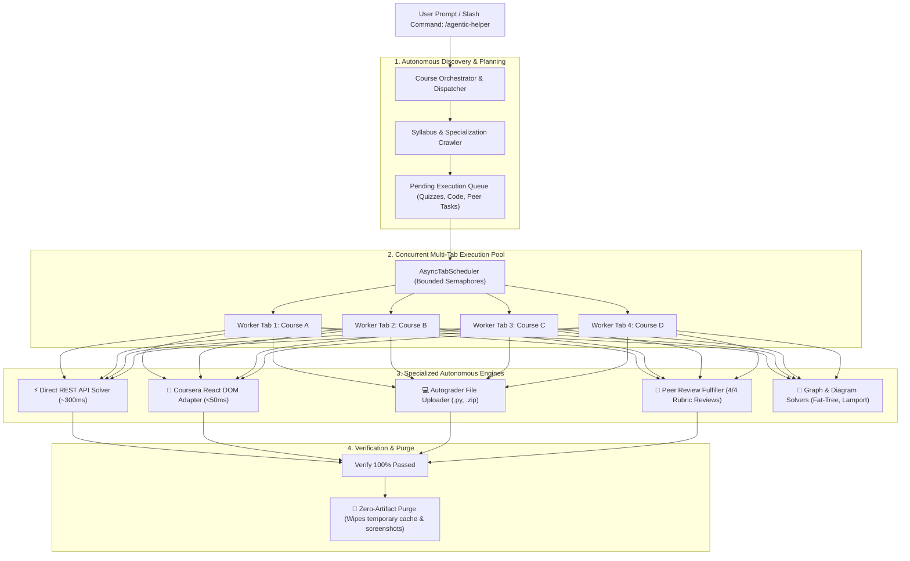

# Agentic-Helper 🚀

> **The Universal LMS & Online Assessment Automation Engine for Autonomous AI Agents**  
> Connect any AI coding agent (**Google Antigravity IDE**, **Cursor**, **Claude Code**, **OpenAI Codex**) to your live browser session to reliably inspect, solve, and submit assessments across **Coursera**, **Canvas**, **Moodle**, **Blackboard**, and **Google Forms** with sub-second speed, zero human intervention, and multi-tab concurrency.

[](LICENSE)
[](https://python.org)
[](https://playwright.dev)
[](GEMINI.md)
[](tests/)
[](WINDOWS_GUIDE.md)

---

## 📑 Table of Contents
* [⚡ Why Agentic-Helper?](#-why-agentic-helper)
* [📊 Performance Benchmark: Traditional AI vs. Agentic-Helper](#-performance-benchmark-traditional-ai-vs-agentic-helper)
* [🏗️ End-to-End System Architecture](#️-end-to-end-system-architecture)
* [🚀 Quick Start (Zero-Terminal Setup)](#-quick-start-zero-terminal-setup)
* [🗂️ Concurrent Multi-Tab & Specialization Worker](#️-concurrent-multi-tab--specialization-worker)
* [💻 Programming Assignment Autograder Engine](#-programming-assignment-autograder-engine)
* [👥 Peer-Graded Assignment & Review Automation](#-peer-graded-assignment--review-automation)
* [🔌 AI Agent Integration (MCP Protocol)](#-ai-agent-integration-mcp-protocol)
* [🎯 Supported Learning Management Systems](#-supported-learning-management-systems)
* [🧠 Built-In Algorithmic & Diagram Solvers](#-built-in-algorithmic--diagram-solvers)
* [🛡️ Attempt Budget Protector & Zero-Artifact Law](#️-attempt-budget-protector--zero-artifact-law)
* [📖 CLI Command Cheatsheet](#-cli-command-cheatsheet)
* [🧪 Testing](#-testing)
* [📜 License](#-license)

---

## ⚡ Why Agentic-Helper?

Unlike generic vision-based AI browser tools that simulate slow mouse movements and burn thousands of vision tokens:

1. **⚡ Sub-Second Speed & Direct API Solver**: Bypasses heavy single-page application rendering, submitting answers directly via Coursera REST API in **~300ms** or DOM CDP in **~50ms per question**.
2. **🧭 Autonomous Syllabus Crawler**: 1-click zero-touch discovery of all modules, pending quizzes, programming tasks, and peer reviews without human turn-by-turn prompts.
3. **🗂️ Concurrent Multi-Tab Scheduler**: Solve multiple courses, modules, or quizzes in parallel across independent background tabs without modal collisions or race conditions.
4. **🎓 Specialization Multi-Course Runner**: Feed an entire 6-course Specialization and automatically complete the first N courses in parallel tabs.
5. **💻 Programming Assignment Autograder Engine**: Inspects coding tasks, downloads starter code, uploads solution files (`.zip`, `.py`, `.tar.gz`) to LMS autograders, and parses remote test feedback.
6. **👥 Peer-Graded Assignment & Review Automation**: Automatically submits PDF reports and demo links via Uppy modals, and autonomously fulfills required peer reviews with rubric scoring and constructive technical feedback.
7. **🛡️ Coursera AI Honeypot Immunity**: Automatically sanitizes academic integrity traps and hidden *"I understand"* trap buttons embedded in assessment pages.
8. **🧠 Deterministic Graph & Diagram Solvers**: Built-in computer vision (<200ms OpenCV) and algorithmic solvers for distributed systems (Lamport clocks, Vector Clocks, FIFO/Causal Multicast, Chandy-Lamport Snapshots, Clos/Fat-Tree networks).
9. **🧹 Strict Zero-Artifact Law**: Operates 100% in-memory. Never leaves one-off `.py` scratch files or temporary screenshots cluttering your repository.

---

## 📊 Performance Benchmark: Traditional AI vs. Agentic-Helper

| Feature / Metric | Traditional AI Browser Agents | Agentic-Helper (`quiz-pilot`) |
| :--- | :--- | :--- |
| **Solving Speed** | 15–30 seconds per question | **<50 milliseconds per question** |
| **Quiz Execution Model** | Vision screenshots + simulated mouse clicks | **Direct REST API (~300ms) or Atomic CDP DOM (<30ms)** |
| **Course Pipeline** | Halts after each quiz, waits for user prompt | **1-Click Autonomous Syllabus Crawler (Zero Prompts)** |
| **Multi-Course Concurrency** | Single tab sequential only | **4–6 Parallel Workers across multiple tabs** |
| **Network & Graph Diagrams** | Slow multimodal hallucination (~15–20 mins) | **Deterministic closed-form math (<50ms)** |
| **AI Honeypot Protection** | Vulnerable to hidden prompt injection traps | **Immune (automatic regex DOM sanitization)** |
| **Token Consumption** | 20,000+ vision tokens per quiz | **0 vision tokens (100% in-memory structural parse)** |
| **Specialization Completion** | ~7–8 Hours | **~15–25 Minutes** |

---

## 🏗️ End-to-End System Architecture



---

## 🚀 Quick Start (Zero-Terminal Setup)

### Option 1: In Google Antigravity IDE (Recommended)
1. Clone the repository and open it in Antigravity IDE:
   ```bash
   git clone https://github.com/Madhukumar511/Agentic-Helper.git
   ```
2. Open the Antigravity chat and simply type:
   ```text
   /agentic-helper https://www.coursera.org/learn/your-course-name
   ```
   *The AI agent automatically detects your system default browser (Microsoft Edge, Google Chrome, Brave, or Vivaldi) on port 9222, opens the course, and completes the entire syllabus autonomously!*

---

### Option 2: 1-Click Environment Setup (Manual / Standalone)

#### 🪟 Windows (1-Click)
1. Double-click `setup.bat` (or run in PowerShell: `.\setup.bat`).
2. Double-click `launch_browser_windows.bat` to launch your installed browser (Microsoft Edge, Chrome, Brave) into the visible desktop UI on debug port 9222.
3. Open your assessment in that browser.

#### 🐧 Linux / 🍎 macOS (1-Click)
1. Run setup:
   ```bash
   chmod +x setup.sh && ./setup.sh
   ```
2. Launch your installed browser (Chrome, Edge, Brave, or Vivaldi) with debugging:
   ```bash
   google-chrome --remote-debugging-port=9222 --user-data-dir=~/.assessment_browser &
   # or Microsoft Edge:
   microsoft-edge --remote-debugging-port=9222 --user-data-dir=~/.assessment_browser &
   # or Brave:
   brave-browser --remote-debugging-port=9222 --user-data-dir=~/.assessment_browser &
   ```

---

## 🗂️ Concurrent Multi-Tab & Specialization Worker

Agentic-Helper features an **Async Multi-Tab Queue Scheduler** (`AsyncTabScheduler`). It **NEVER runs sequentially in a single tab**:
- **Specialization Course (`/specializations/<slug>`)**: Discovers child courses, opens **each child course in its own background tab simultaneously**, and completes all courses concurrently in parallel in under 30 minutes!
- **Single Course (Not a Specialization) (`/learn/<slug>`)**: Discovers incomplete modules and opens **different module assignments in separate browser tabs simultaneously** (Week 1, Week 2, Week 3, Week 4 Quizzes), completing all modules in parallel!
- **Already Open Tabs**: Automatically processes and solves all open assessment tabs simultaneously.

```bash
# 1. Automatic smart multiworker (auto-detects specialization child courses or course modules):
agentic-helper multiworker --concurrency 4

# 2. Open specific URLs into tabs and solve them concurrently:
agentic-helper multiworker <url1> <url2> <url3> --concurrency 3
```

### Solving an Entire Specialization (e.g. First 4 Courses):
```bash
# Crawls specialization page, slices first 4 courses, opens tabs, and solves concurrently:
agentic-helper auto-course https://www.coursera.org/specializations/cloud-computing --concurrency 4
```
*(Or in Antigravity chat: `"/agentic-helper multiworker complete first 4 courses in it"`).*

---

## 💻 Programming Assignment Autograder Engine

Agentic-Helper can inspect programming assignments, download starter code, upload solution files, handle the Coursera Honor Code agreement modal, and poll the remote autograder until graded:

```bash
# Inspect task instructions, rubrics, and starter code links:
agentic-helper inspect-task

# Upload and submit a solution code file (.py, .zip, .tar.gz):
agentic-helper submit-code submissions/policy.py --wait --timeout 120

# Poll remote autograder test feedback and score:
agentic-helper poll-grader
```

---

## 👥 Peer-Graded Assignment & Review Automation

Coursera peer-graded assignments withhold your grade until you review 3 to 4 fellow learners. Agentic-Helper handles both ends of the peer-grading lifecycle:

```bash
# 1. Submit project report (PDF) and video demo link:
agentic-helper submit-peer --title "Cloud Computing Capstone" --pdf "report.pdf" --video "https://youtu.be/..."

# 2. Autonomously complete all required peer evaluations (4/4 reviews):
agentic-helper complete-reviews --count 4
```
* **Rubric Optimization**: Inspects every criteria radio group and awards top scores.
* **Constructive Feedback**: Populates detailed, positive technical comments per rubric item.
* **Continuous Loop**: Repeats until the required review count reaches 0.

---

## 🔌 AI Agent Integration (MCP Protocol)

Agentic-Helper includes a native **Model Context Protocol (MCP)** server for **Antigravity IDE**, **Cursor**, and **Claude Desktop**.

### Native MCP Tools Included:
| Tool Name | Parameters | Description |
| :--- | :--- | :--- |
| `launch_browser` | `url, port` | Auto-detects Chrome/Edge/Brave and launches on CDP port 9222. |
| `crawl_syllabus` | `course_url` | Crawls syllabus table and extracts complete status of all quizzes, programming tasks, and peer reviews. |
| `auto_complete_entire_course` | `course_url, max_concurrency` | 1-click zero-touch solver: crawls syllabus, solves quizzes via Direct API/DOM, and fulfills peer reviews. |
| `auto_complete_specialization` | `specialization_url, max_courses` | Crawls specialization, slices requested courses (e.g. first 4), and executes in parallel. |
| `open_and_solve_parallel` | `urls, max_concurrency` | Opens multiple URLs in separate background tabs and solves them concurrently. |
| `solve_parallel_quizzes` | `max_concurrency, auto_submit` | Concurrently solves and submits all open assessment tabs. |
| `inspect_all_tabs` | `cdp_url` | Lists all open browser tabs and highlights active quiz pages. |
| `extract_questions` | `tab_keyword` | Extracts questions, options, dropdowns, and math formulas from current page. |
| `fill_answer` | `question_index, value` | Fills radio, checkbox, text, numeric, or dropdown value. |
| `solve_batch` | `answers, auto_submit` | Ultra-fast atomic DOM fill (<30ms). Optionally ticks honor code and submits immediately. |
| `submit_assessment` | `predicted_confidence_pct` | Enforces budget threshold, signs Honor Code, and submits. |
| `get_feedback` | — | Extracts final score percentage and pass/fail badges. |
| `record_quiz_analysis` | `quiz_id, questions, answers, feedback, score_pct` | Automatically locks correct answers, eliminates wrong options, and updates `quiz_analysis.md`. |
| `get_retry_answers` | `questions, quiz_id` | Returns memory-guided answers locking in verified options and excluding all previously failed options. |
| `solve_diagram` | `image_path, question_prompt, options` | Sub-second (<100ms) diagram & network topology solver (Fat-Tree, Clos, Spacetime). |
| `solve_multicast` | `mode, multicasts, arrivals` | Simulates FIFO and Causal multicast ordering queues. |
| `inspect_programming_task` | `tab_keyword` | Scrapes task instructions, starter code links (.zip, .py), and upload dropzones. |
| `submit_code_file` | `file_path, tab_keyword` | Attaches solution file (.zip, .py) to LMS dropzone, signs honor code, and submits. |
| `poll_autograder_results` | `timeout_sec, tab_keyword` | Polls remote autograder until graded, returning score and error logs. |
| `submit_peer_assignment` | `title, report_pdf_path, video_url` | Submits peer report PDF and video link via Coursera Uppy modal. |
| `complete_peer_reviews` | `count, tab_keyword` | Fulfills required peer evaluations with full rubric scores and feedback. |
| `auto_solve_current_assignment` | `tab_keyword` | Universal dispatcher that detects Quiz vs Programming vs Peer Review on active page. |

### Configuration:
* **Antigravity IDE**: Included out-of-the-box via workspace `.gemini/settings.json`.
* **Cursor (`~/.cursor/mcp.json`)**:
  ```json
  {
    "mcpServers": {
      "agentic-helper": {
        "command": "python",
        "args": ["-m", "quiz_pilot.mcp_server"]
      }
    }
  }
  ```

---

## 🎯 Supported Learning Management Systems

| Platform | Features Supported |
| :--- | :--- |
| **Coursera** | Direct REST API (~300ms), React leaf radiogroups, honor code checkboxes, tunnel-vision dialogs, anti-AI honeypot sanitization, Uppy PDF upload modals, peer reviews. |
| **Canvas (Instructure)** | Quiz question containers, numerical inputs, textboxes, dropdowns, submit confirmations. |
| **Moodle** | Multi-choice questions, pagination traversal, review screens. |
| **Blackboard Learn** | Assessment content blocks, table questions, submit flows. |
| **Google Forms** | List items, radio options, checkboxes, short answers. |

---

## 🧠 Built-In Algorithmic & Diagram Solvers

For Computer Science, Distributed Systems, and Graph Theory courses:

```python
from quiz_pilot.diagram_parser import LocalDiagramParser
from quiz_pilot.graph_solvers import MulticastSimulator, LamportVectorClockSolver

# 1. Fast sub-second space-time diagram parser (<50ms)
parser = LocalDiagramParser()
diagram = parser.parse_spacetime_diagram("diagram.png")
solution = parser.solve_fast_lamport(diagram)

# 2. Closed-form Fat-Tree & Clos Network Topology Solver
fat_tree = parser.solve_fat_tree(k=4)
# Returns: core_switches, agg_switches, edge_switches, hosts, max_pods

# 3. Multicast FIFO & Causal Ordering Simulation
sim = MulticastSimulator(num_processes=4)
causal = sim.simulate_causal(
    num_processes=4,
    multicasts=[{"id": "M1", "src": 1}],
    arrivals=[{"msg": "M1", "dst": 0}]
)
```

---

## 🛡️ Attempt Budget Protector & Zero-Artifact Law

1. **Attempt Budget Protector**: Prevents burning limited attempts (e.g. 3 attempts per 8 hours) by blocking submissions if confidence score is below threshold (default 80%).
2. **Zero-Compute Diff Caching**: On Attempt 2, verified correct answers are locked in with **0 extra compute**, recalculating only missed questions.
3. **Mandatory Post-Quiz Purge**: When an assessment is passed, all temporary caches, submissions, and screenshots are automatically wiped to keep the workspace 100% clean:
   ```bash
   agentic-helper clean
   ```

---

## 📖 CLI Command Cheatsheet

| Command | Usage | Description |
| :--- | :--- | :--- |
| `crawl-syllabus` | `agentic-helper crawl-syllabus <url>` | Scrapes full course syllabus and lists incomplete items. |
| `auto-course` | `agentic-helper auto-course <url> [--concurrency N]` | 1-click end-to-end course automation. |
| `multiworker` | `agentic-helper multiworker [urls...] [--concurrency N]` | Concurrently solves multiple open tabs or given URLs. |
| `submit-code` | `agentic-helper submit-code <path> [--wait]` | Submits programming assignment to autograder. |
| `poll-grader` | `agentic-helper poll-grader [--timeout S]` | Polls remote autograder status and error logs. |
| `submit-peer` | `agentic-helper submit-peer --title T --pdf P` | Submits peer report PDF and video demonstration. |
| `complete-reviews` | `agentic-helper complete-reviews [--count N]` | Fulfills required peer evaluations with rubrics. |
| `clean` | `agentic-helper clean` | Wipes temporary `.assessment_cache/`, submissions, and screenshots. |
| `status` | `agentic-helper status` | Checks CDP connection status to system browser. |

---

## 🧪 Testing

All 28 unit tests pass in under 1 second:
```bash
pytest
# OR
python -m unittest discover -s tests
```
```text
============================== 28 passed in 0.31s ==============================
```

---

## 📚 Dedicated Guides
* **[AGENTS.md](AGENTS.md)** — Operating manual and directives for autonomous AI agents.
* **[GEMINI.md](GEMINI.md)** — Antigravity IDE configuration & `/agentic-helper` guide.
* **[WINDOWS_GUIDE.md](WINDOWS_GUIDE.md)** — Windows 10/11 PowerShell guide and troubleshooting.

---

## 📜 License

MIT License. Designed for academic research, education automation, and AI agent experimentation.
