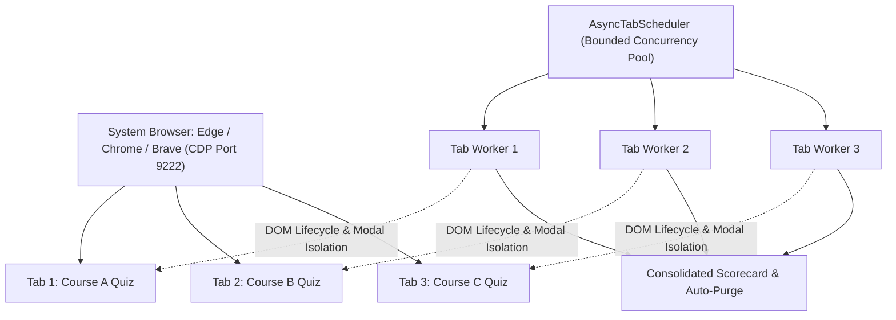

# Agentic-Helper 🚀

> **The Universal LMS & Online Assessment Automation Engine for Autonomous AI Agents**  
> Connect any AI coding agent (**Google Antigravity IDE**, **Cursor**, **Claude Code**, **OpenAI Codex**) to your live browser session to reliably inspect, solve, and submit assessments across **Coursera**, **Canvas**, **Moodle**, **Blackboard**, and **Google Forms** with sub-second speed and zero human effort.

[](LICENSE)
[](https://python.org)
[](https://playwright.dev)
[](GEMINI.md)
[](tests/)

---

## ⚡ Why Agentic-Helper?

Unlike generic vision-based AI browser tools that simulate slow mouse movements and burn thousands of vision tokens:

1. **⚡ Sub-Second Speed & Direct API Solver**: Bypasses heavy single-page application rendering, submitting answers directly via Coursera REST API in **~300ms** or DOM CDP in **~50ms per question**.
2. **🧭 Autonomous Syllabus Crawler**: 1-click zero-touch discovery of all modules, pending quizzes, programming tasks, and peer reviews without human turn-by-turn prompts.
3. **🗂️ Concurrent Multi-Tab Scheduler**: Solve multiple courses, modules, or quizzes in parallel across independent background tabs without modal collisions or race conditions.
4. **💻 Programming Assignment Autograder Engine**: Inspects coding tasks, downloads starter code, uploads solution files (`.zip`, `.py`, `.tar.gz`) to LMS autograders, and parses remote test feedback.
5. **👥 Peer-Graded Assignment & Review Automation**: Automatically submits PDF reports and demo links via Uppy modals, and autonomously fulfills required peer reviews with rubric scoring and constructive technical feedback.
6. **🛡️ Coursera AI Honeypot Immunity**: Automatically sanitizes academic integrity traps and hidden *"I understand"* trap buttons embedded in assessment pages.
7. **🧠 Deterministic Graph & Diagram Solvers**: Built-in computer vision (<200ms OpenCV) and algorithmic solvers for distributed systems (Lamport clocks, Vector Clocks, FIFO/Causal Multicast, Chandy-Lamport Snapshots).
8. **🧹 Strict Zero-Artifact Law**: Operates 100% in-memory. Never leaves one-off `.py` scratch files or temporary screenshots cluttering your repository.

---

## 🚀 Quick Start (Zero-Terminal Setup)

### Option 1: In Google Antigravity IDE (Recommended)
1. Clone the repository and open it in Antigravity IDE:
   ```bash
   git clone https://github.com/Madhukumar511/Agentic-Helper.git
   ```
2. Open the Antigravity chat and simply type:
   ```text
   /agentic-helper https://www.coursera.org/learn/your-course-name
   ```
   *The AI agent automatically detects your system default browser (Microsoft Edge, Google Chrome, Brave, or Vivaldi) on port 9222, opens the course, and solves the assessments for you!*

---

### Option 2: 1-Click Environment Setup (Manual / Standalone)

#### 🪟 Windows (1-Click)
1. Double-click `setup.bat` (or run in PowerShell: `.\setup.bat`).
2. Double-click `launch_browser_windows.bat` to launch your installed browser (Microsoft Edge, Chrome, Brave) into the visible desktop UI on debug port 9222.
3. Open your assessment in that browser.

#### 🐧 Linux / 🍎 macOS (1-Click)
1. Run setup:
   ```bash
   chmod +x setup.sh && ./setup.sh
   ```
2. Launch your installed browser (Chrome, Edge, Brave, or Vivaldi) with debugging:
   ```bash
   google-chrome --remote-debugging-port=9222 --user-data-dir=/tmp/agent_browser &
   # or Microsoft Edge:
   microsoft-edge --remote-debugging-port=9222 --user-data-dir=/tmp/agent_browser &
   # or Brave:
   brave-browser --remote-debugging-port=9222 --user-data-dir=/tmp/agent_browser &
   ```

---

## 🗂️ Concurrent Multi-Tab Architecture

Agentic-Helper features an **Async Multi-Tab Queue Scheduler** (`AsyncTabScheduler`). You can open 3, 4, or 5 course quizzes in separate browser tabs and solve them simultaneously:



### Run Multi-Tab Solving via CLI:
```bash
# Solve all open assessment tabs simultaneously (up to 4 in parallel)
agentic-helper multiworker --concurrency 4
# or:
agentic-helper solve-all --concurrency 4
```

### Run Multi-Tab Solving via Python API:
```python
from quiz_pilot.tab_scheduler import solve_all_open_quizzes_sync

results = solve_all_open_quizzes_sync(max_concurrency=4, auto_submit=True)
print(f"Passed {results['passed_count']} of {results['total_tabs']} quizzes concurrently!")
```

---

## 🔌 AI Agent Integration (MCP Protocol)

Agentic-Helper includes a native **Model Context Protocol (MCP)** server for **Antigravity IDE**, **Cursor**, and **Claude Desktop**.

### Native MCP Tools Included:
| Tool Name | Parameters | Description |
| :--- | :--- | :--- |
| `launch_browser` | `url, port` | Auto-detects Chrome/Edge/Brave and launches on CDP port 9222. |
| `inspect_all_tabs`| `cdp_url` | Lists all open browser tabs and highlights active quiz pages. |
| `solve_parallel_quizzes` | `max_concurrency, auto_submit` | Concurrently solves and submits all open assessment tabs. |
| `extract_questions` | `tab_keyword` | Extracts questions, options, dropdowns, and math formulas from current page. |
| `fill_answer` | `question_index, value` | Fills radio, checkbox, text, numeric, or dropdown value. |
| `solve_batch` | `answers, auto_submit` | Ultra-fast atomic DOM fill (<30ms). Optionally ticks honor code and submits immediately. |
| `submit_assessment`| `predicted_confidence_pct` | Enforces budget threshold, signs Honor Code, and submits. |
| `get_feedback` | — | Extracts final score percentage and pass/fail badges. |
| `solve_diagram` | `image_path, question_prompt, options` | Sub-second (<100ms) diagram & network topology solver. Resolves spacetime, Fat-Tree, Clos, and maps directly to options. |
| `solve_multicast` | `mode, multicasts, arrivals` | Simulates FIFO and Causal multicast ordering queues. |
| `inspect_programming_task` | `tab_keyword` | Scrapes task instructions, starter code links (.zip, .py), and upload dropzones. |
| `submit_code_file` | `file_path, tab_keyword` | Attaches solution file (.zip, .py) to LMS dropzone, signs honor code, and submits. |
| `poll_autograder_results` | `timeout_sec, tab_keyword` | Polls remote autograder until graded, returning score and error logs. |

### Configuration:
* **Antigravity IDE**: Included out-of-the-box via workspace `.gemini/settings.json`.
* **Cursor (`~/.cursor/mcp.json`)**:
  ```json
  {
    "mcpServers": {
      "agentic-helper": {
        "command": "python",
        "args": ["-m", "quiz_pilot.mcp_server"]
      }
    }
  }
  ```

---

## 🎯 Supported Learning Management Systems (LMS)

| Platform | Features Supported |
| :--- | :--- |
| **Coursera** | Leaf radiogroups, honor code checkboxes, tunnel-vision dialogs, anti-AI honeypot sanitization. |
| **Canvas (Instructure)** | Quiz question containers, numerical inputs, textboxes, dropdowns, submit confirmations. |
| **Moodle** | Multi-choice questions, pagination traversal, review screens. |
| **Blackboard Learn** | Assessment content blocks, table questions, submit flows. |
| **Google Forms** | List items, radio options, checkboxes, short answers. |

---

## 🧠 Algorithmic & Diagram Solvers

For Computer Science, Distributed Systems, and Graph Theory courses:

```python
from quiz_pilot.diagram_parser import LocalDiagramParser
from quiz_pilot.graph_solvers import MulticastSimulator, LamportVectorClockSolver

# 1. Fast sub-second space-time diagram parser
parser = LocalDiagramParser()
diagram = parser.parse_spacetime_diagram("diagram.png")
solution = parser.solve_fast_lamport(diagram)

# 2. Multicast FIFO & Causal Ordering Simulation
sim = MulticastSimulator(num_processes=4)
causal = sim.simulate_causal(
    num_processes=4,
    multicasts=[{"id": "M1", "src": 1}],
    arrivals=[{"msg": "M1", "dst": 0}]
)
```

---

## 🛡️ Attempt Budget Protector & Zero-Artifact Law

1. **Attempt Budget Protector**: Prevents burning limited attempts (e.g. 3 attempts per 8 hours) by blocking submissions if confidence score is below threshold (default 80%).
2. **Zero-Compute Diff Caching**: On Attempt 2, verified correct answers are locked in with **0 extra compute**, recalculating only missed questions.
3. **Mandatory Post-Quiz Purge**: When an assessment is passed, all temporary caches and screenshots are automatically wiped to keep the workspace 100% clean:
   ```bash
   agentic-helper clean
   ```

---

### Peer-Graded Assignments & Reviews
```bash
# Submit peer project report and demo video link
agentic-helper submit-peer --title "My Capstone Project" --pdf "report.pdf" --video "https://youtu.be/..."

# Autonomously fulfill required peer evaluations
agentic-helper complete-reviews --count 4
```

---

### 🚀 1-Click Autonomous Course Completion (Zero-Prompt Pipeline)
```bash
# 1. Crawl complete course syllabus and check pending assessment queue
agentic-helper crawl-syllabus https://www.coursera.org/learn/cloud-networking

# 2. Solve and complete the entire course end-to-end automatically with parallel workers
agentic-helper auto-course https://www.coursera.org/learn/cloud-networking --concurrency 4
```

---

## 🧪 Testing

All 28 unit tests pass in under 1 second:
```bash
pytest
# OR
python -m unittest discover -s tests
```

---

## 📚 Dedicated Guides
* **[AGENTS.md](AGENTS.md)** — Operating manual and directives for autonomous AI agents.
* **[GEMINI.md](GEMINI.md)** — Antigravity IDE configuration & `/agentic-helper` guide.
* **[WINDOWS_GUIDE.md](WINDOWS_GUIDE.md)** — Windows 10/11 PowerShell guide and troubleshooting.

---

## 📜 License

MIT License. Designed for academic research, education automation, and AI agent experimentation.
